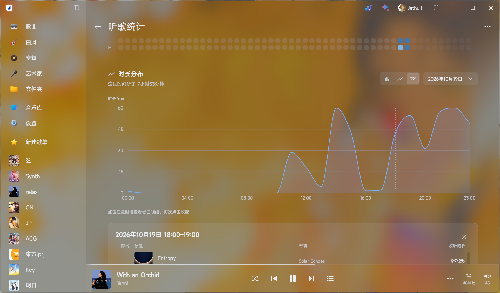
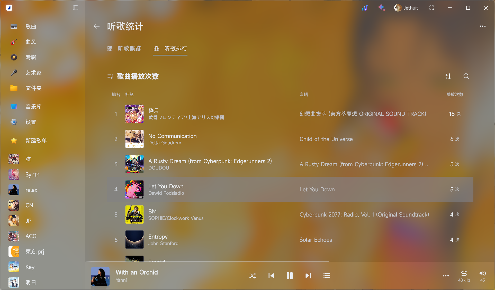
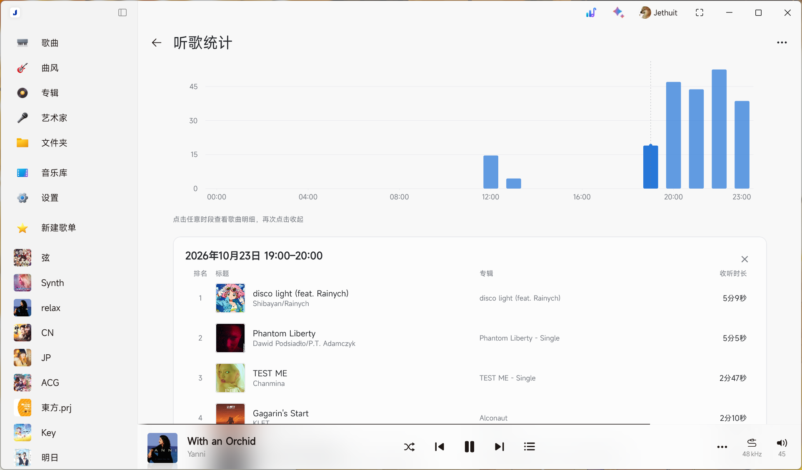
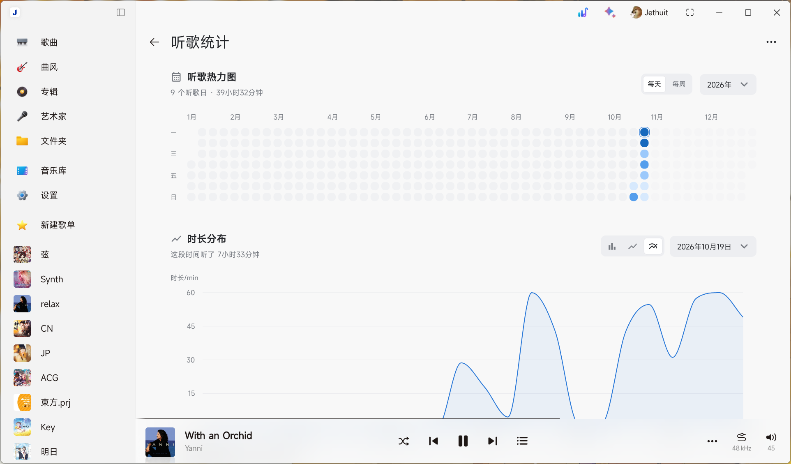

# 听歌统计

为 Salt Player for Windows（SPW）提供本地听歌统计，记录并展示个人听歌习惯。

**当前版本：v0.3.1** · [更新日志](docs/releases/v0.3.1.md)

## 功能介绍

| 功能 | 说明 |
|---|---|
| 听歌概览 | 累计时长、听歌天数、连续听歌记录 |
| 听歌热力图 | 按日或周展示听歌时长，自动调整颜色分级 |
| 时长分布 | 按小时、日期或每七天统计，支持柱状图、折线图和平滑曲线 |
| 听歌排行 | 歌曲、歌手、专辑播放次数排行，支持搜索与分页 |
| 歌曲明细 | 查看指定时段内的歌曲及对应收听时长 |
| 数据管理 | 本地备份导入、导出与合并去重 |
| 主题适配 | 跟随 SPW 深浅主题，支持椒盐经典、亚克力、云母及云母 Alt |

## 实际效果图

### 听歌概览与歌曲明细（深色材质）

### 听歌排行（深色材质）

### 时长分布与歌曲明细（浅色）

### 听歌热力图（浅色）

## 安装与使用

1. 从 [GitHub Releases](https://github.com/Jethuit/SPW-Listen-Stats/releases) 下载 `.spmod` 安装包。
2. 在 SPW 模组管理中本地导入并启用。
3. 点击窗口顶部的听歌统计图标，或通过模组配置打开统计页面。

无需额外安装运行环境。

## 注意事项

- 所有统计数据与备份均保存在本地。
- 历史记录受播放器保留范围限制，部分旧数据可能存在偏差。
- 当前版本基于 SPW 1.19.2 构建，后续宿主更新可能影响兼容性。

## 反馈与许可

问题反馈：[GitHub Issues](https://github.com/Jethuit/SPW-Listen-Stats/issues)

项目采用 [MIT License](LICENSE)，第三方组件声明见 [THIRD-PARTY.md](docs/THIRD-PARTY.md)。
