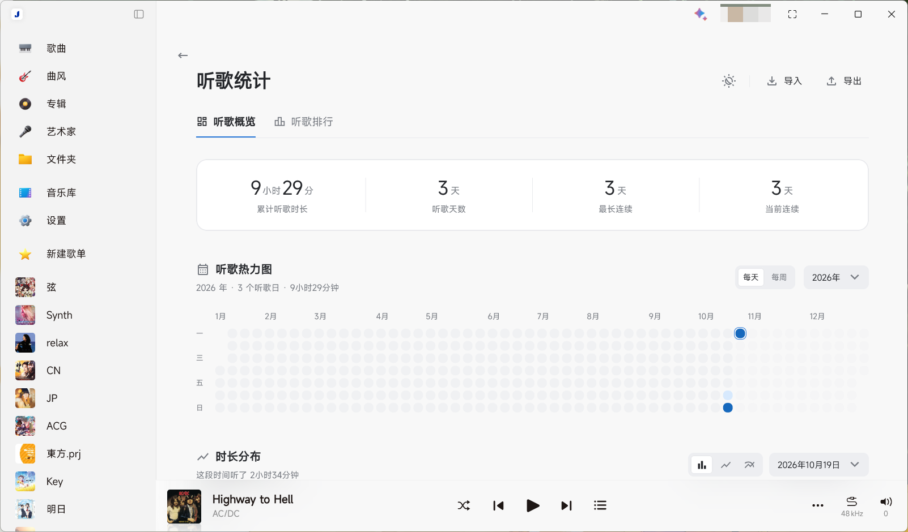
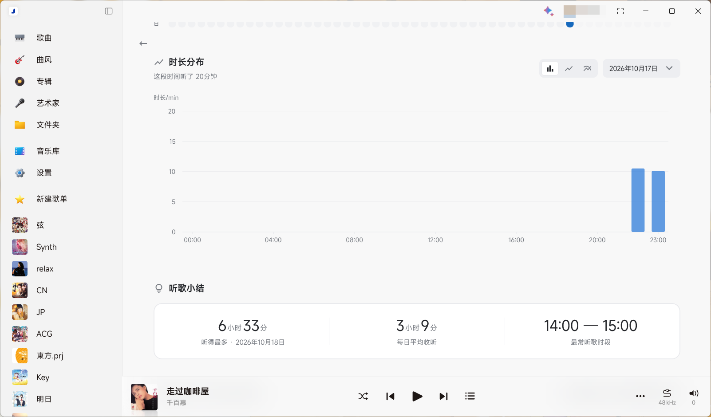
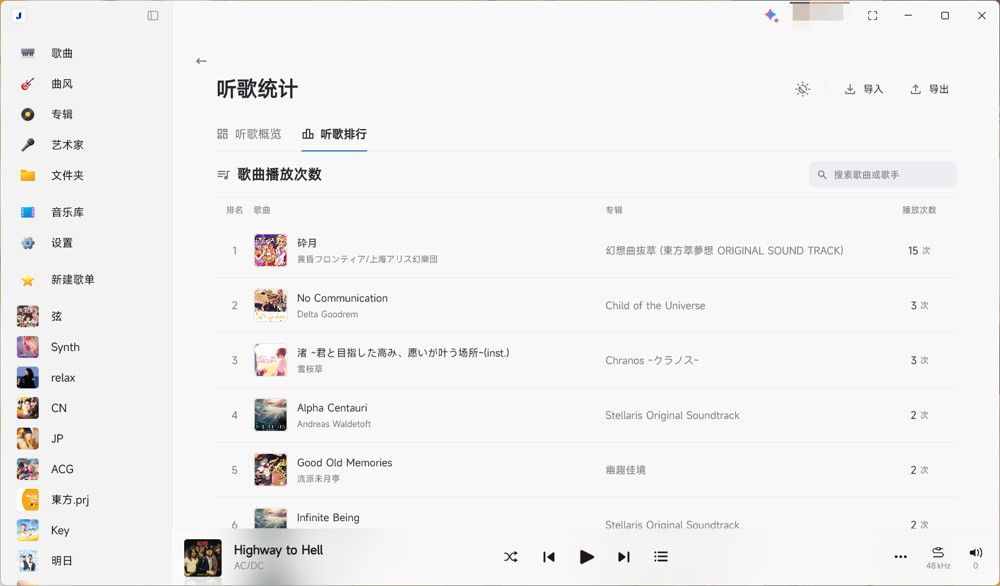

# SPW热力图&排行

为 Salt Player for Windows 提供本地听歌概览与歌曲排行。

首个预发布版为 **v0.1.0**，面向 **SPW 1.19.0**。其他宿主版本尚未验证，已知边界见[发布说明](docs/releases/v0.1.0.md)。

> 推荐在 SPW 中使用 **“椒盐经典”主题样式**，以获得最佳体验。

## 功能

- 累计听歌时长、听歌天数、最长连续与当前连续天数。
- 每天／每周热力图，支持按年份或近一年查看。
- 按小时、日期或每七天汇总的时长分布，支持柱状、折线和平滑曲线。
- 每首歌曲独立累计有效播放次数，实际听满单曲 50% 计一次；支持歌名／歌手搜索，每页 25 首。
- 跟随 SPW、浅色、深色三种主题，以及本地备份导入、导出与合并去重。

## 实际效果图

以下为用户提供的实际运行截图。

### 听歌概览与热力图



### 时长分布与听歌小结



### 听歌排行



## 安装与打开

1. 从 [GitHub Releases](https://github.com/Jethuit/SPW-Listen-Stats/releases) 下载 `.spmod` 安装包。
2. 在 SPW 创意工坊／模组管理中使用本地导入。
3. 授权 `library-read`（读取曲库）和 `class-transform`（界面 Hook），启用模组。
4. 在模组配置中点击 **“打开听歌统计”**。

安装包不要求用户额外安装 Java 或 Kotlin。附件 `SHA256SUMS.txt` 可用于核对下载文件。

## 数据与兼容性

统计与备份保存在本机。插件只读宿主数据库中的听歌记录，同时记录启用后观察到的实际收听片段；不根据曲库数量推算过去的历史。

- 宿主旧历史缺少暂停等精细片段，小时分布属于近似；历史可见范围取决于宿主保留的数据。
- 实时记录与宿主记录仍通过启发式匹配。真实播放、暂停、拖动、循环和落库去重仍需继续实机验收。
- 曲库删除重建或跨设备后，歌曲 ID 不保证一致；旧 v1 汇总备份采用保守合并，可能少计。
- 页面入口依赖 SPW 1.19.0 的内部 Hook。封面仅支持 API 可读的内嵌封面；缺失时显示占位图。
- Acrylic／Mica 等背景暂回退为经典配色。最新日期弹窗的键盘、缩放与滚动仍需实机核对。

完整边界及反馈方式见[首版发布说明](docs/releases/v0.1.0.md)。问题可通过 [Issues](https://github.com/Jethuit/SPW-Listen-Stats/issues) 反馈。

## 开发

正式模组在 `plugin/`，使用 Kotlin、Compose 和 SaltUI。`preview/` 是已确认的 HTML 视觉参考，示例数据和正式统计独立；详情见[预览说明](docs/PREVIEW.md)。

源码构建需要本机 SPW 安装目录，以及下载到 `build/tools/` 的 JDK 25、Kotlin、SaltUI 和 SQLite JDBC；宿主文件与构建缓存不提交。把下面路径替换为自己的 SPW 安装目录：

```powershell
py -3.12 tools/prepare_toolchain.py --spw-dir "SPW 安装目录"
py -3.12 tools/build_plugin.py --spw-dir "SPW 安装目录"
py -3.12 tests/spmod-structure.py
py -3.12 tools/prepare_release.py
```

产物为 `build/libs/plugin-com.jethuit.spw.listenstats-0.1.0.spmod`；发布附件整理到 `build/releases/v0.1.0/`。

已有离线回归可分别运行 `py -3.12 tests/run-data-tests.py data`、`ui`、`cover`，需先构建。离线检查不代替宿主验收。

开发细节见[正式实现](docs/NATIVE-IMPLEMENTATION.md)、[需求](docs/REQUIREMENTS.md)、[交接](docs/HANDOFF.md)及[发布准备记录](docs/releases/PREPARATION-v0.1.0.md)。

## 许可证

项目原创代码与文档采用 [MIT License](LICENSE)。SaltUI、sqlite-jdbc 与 Material Symbols 的来源和声明见[第三方组件](docs/THIRD-PARTY.md)，安装包内同时保留许可证及 NOTICE。
