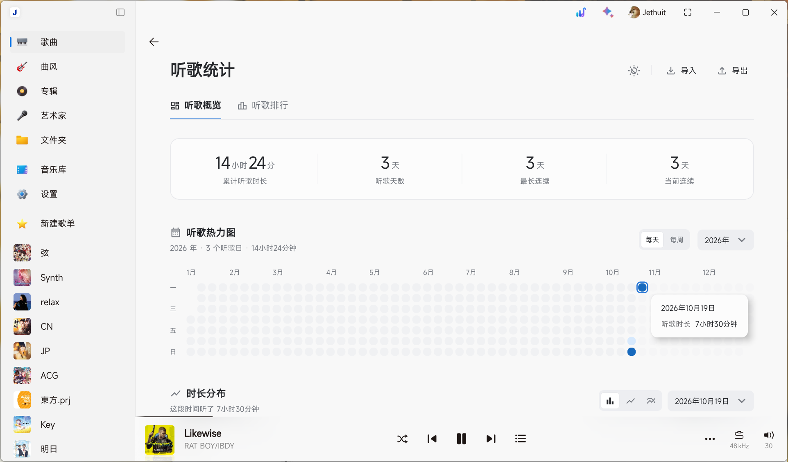
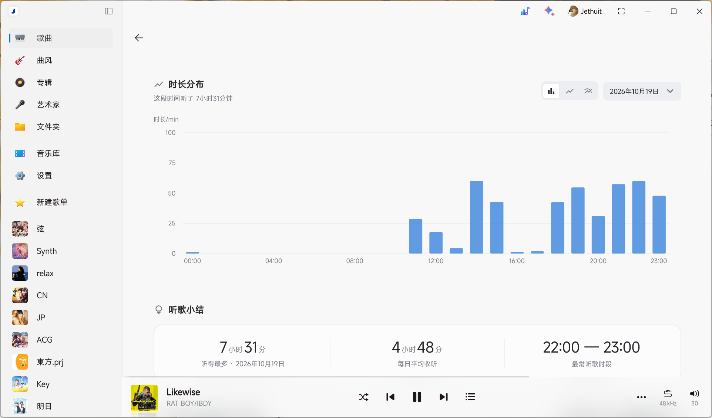
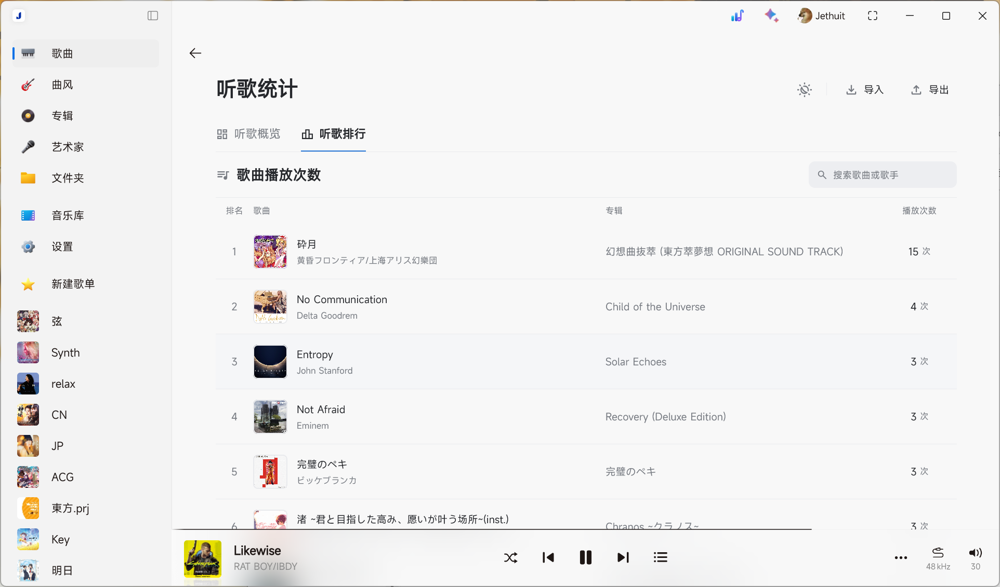

# 听歌统计

为 Salt Player for Windows 提供本地听歌概览，以及歌曲、歌手与专辑排行。

当前版本为 **v0.1.3**，适用于 **SPW 1.19.0**。

> 推荐在 SPW 中使用 **“椒盐经典”主题样式**，以获得最佳体验。

## 功能

- 累计听歌时长、听歌天数、最长连续与当前连续天数。
- 每天／每周热力图，支持按年份或近一年查看。
- 按小时、日期或每七天汇总的时长分布，支持柱状、折线和平滑曲线。
- 每首歌曲独立累计有效播放次数，实际听满单曲 50% 计一次；支持歌名／歌手搜索，每页 25 首。
- 支持切换歌手、专辑排行，按有效播放次数汇总；合作歌曲分别计入每位歌手。歌手封面使用其播放次数最高的专辑封面。
- 跟随 SPW、浅色、深色三种主题，以及本地备份导入、导出与合并去重。

## 实际效果图

### 听歌概览与热力图

### 时长分布与听歌小结

### 听歌排行

## 安装与打开

1. 从 [GitHub Releases](https://github.com/Jethuit/SPW-Listen-Stats/releases) 下载 `.spmod` 安装包。
2. 在 SPW 创意工坊／模组管理中使用本地导入。
3. 按提示授权并启用模组。
4. 点击窗口顶部、彩色快捷按钮左侧的 **听歌统计图标**，即可打开统计页面；也可在模组配置中点击 **“打开听歌统计”**。

安装包可直接导入使用，无需额外安装运行环境。

## 数据与兼容性

统计与备份保存在本机，可展示播放器保留的历史和插件启用后的收听记录。

- 目前适用于 SPW 1.19.0，其他版本的兼容性尚未验证。
- 过去的听歌记录受播放器保留范围限制，旧历史的小时分布可能存在偏差。
- 跨设备或重建曲库后，歌曲记录可能无法自动对应；导入旧版汇总备份时可能少计。
- 封面取自音频内嵌图片，无法读取时显示默认图。
- 亚克力、云母等背景样式暂按经典配色显示，推荐使用“椒盐经典”。

遇到问题可通过 [Issues](https://github.com/Jethuit/SPW-Listen-Stats/issues) 反馈。

## 许可证

项目原创代码与文档采用 [MIT License](LICENSE)。SaltUI、sqlite-jdbc 与 Material Symbols 的来源和声明见[第三方组件](docs/THIRD-PARTY.md)，安装包内同时保留许可证及 NOTICE。
