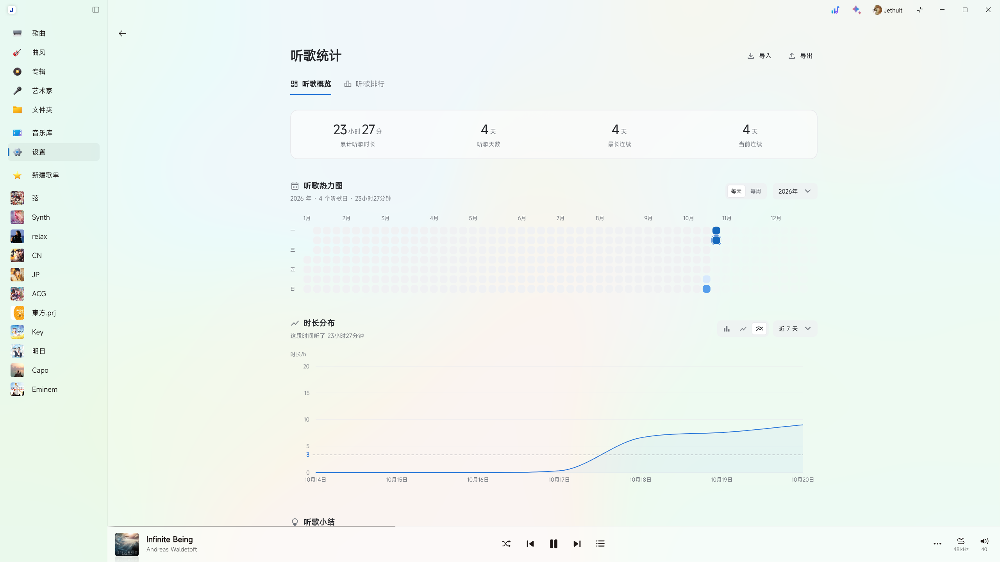
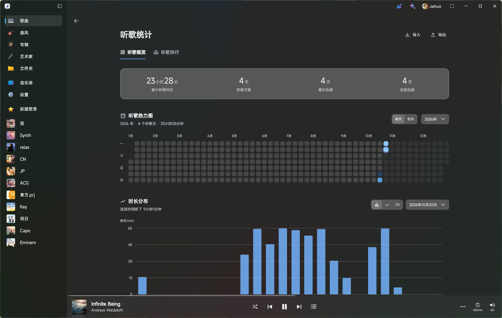
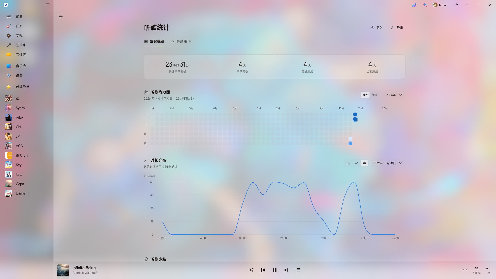
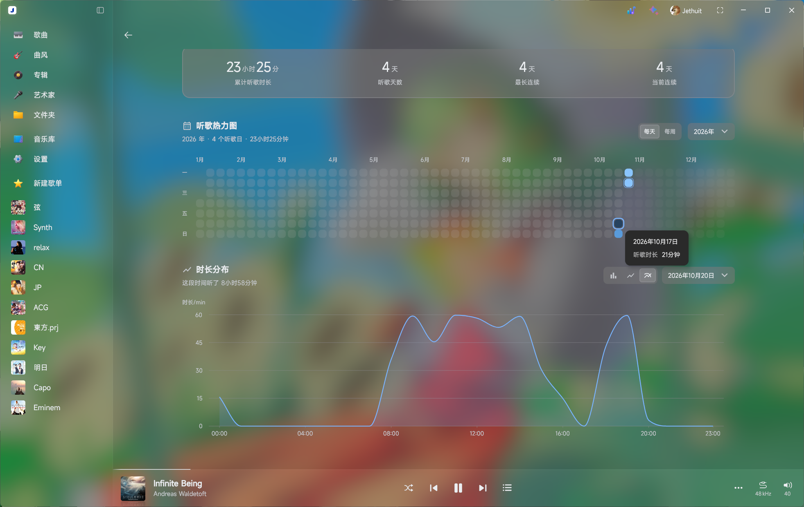
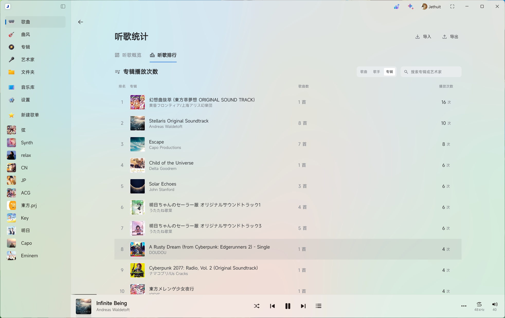

# 听歌统计

为 Salt Player for Windows 提供本地听歌概览，以及歌曲、歌手与专辑排行。

当前版本为 **v0.2.0**，适用于 **SPW 1.19.0**。更新内容见 [v0.2.0 发布说明](docs/releases/v0.2.0.md)。

## 功能

- 累计听歌时长、听歌天数、最长连续与当前连续天数。
- 每天／每周热力图，支持按年份或近一年查看，根据最近 12 个月的听歌时长分布自动计算颜色阈值。
- 按小时、日期或每七天汇总的时长分布，支持柱状、折线和平滑曲线；首次默认“今天＋柱状图”，记忆后续选择。
- 每首歌曲独立累计有效播放次数，实际听满单曲 50% 计一次；支持歌名／歌手搜索，每页默认 25 条，可自行输入每页数量。
- 支持切换歌手、专辑排行，按有效播放次数汇总；合作歌曲分别计入每位歌手。歌手封面使用其播放次数最高的专辑封面。
- 始终跟随 SPW 深浅主题，适配椒盐经典、亚克力、云母和云母 Alt 的背景与列表悬停。
- 时长文字按分钟四舍五入；支持本地备份导入、导出与合并去重。
- 页面进入、退出和切换动画，可在模组配置中关闭；导入、导出合并在右上角“…”菜单。

## 实际效果图

以下为 v0.1.5 截图，v0.2.0 的导航、菜单及热力图样式已更新。

### 听歌概览与热力图（浅色）

### 时长分布（深色柱状图）

### 材质背景（浅色与深色）

### 专辑排行

## 安装与打开

1. 从 [GitHub Releases](https://github.com/Jethuit/SPW-Listen-Stats/releases) 下载 `.spmod` 安装包。
2. 在 SPW 创意工坊／模组管理中使用本地导入。
3. 按提示授权并启用模组。
4. 点击窗口顶部、彩色快捷按钮左侧的 **听歌统计图标**，即可打开统计页面；也可在模组配置中点击 **“打开听歌统计”**。

安装包可直接导入使用，无需额外安装运行环境。

热力图会根据最近 12 个月的非零听歌时长自动计算四档颜色阈值，日与周分别计算，无需手动设置；仅影响显示，不改变听歌记录。旧的“每天听多久算多”设置已移除。

## 数据与兼容性

统计与备份保存在本机，可展示播放器保留的历史和插件启用后的收听记录。

- 目前适用于 SPW 1.19.0，其他版本的兼容性尚未验证。
- 过去的听歌记录受播放器保留范围限制，旧历史的小时分布可能存在偏差。
- 跨设备或重建曲库后，歌曲记录可能无法自动对应；导入旧版汇总备份时可能少计。
- 封面取自音频内嵌图片，无法读取时显示默认图。
- 材质背景依赖宿主窗口与兼容的页面入口；材质接入不可用时使用实色背景。

遇到问题可通过 [Issues](https://github.com/Jethuit/SPW-Listen-Stats/issues) 反馈。

## 许可证

项目原创代码与文档采用 [MIT License](LICENSE)。SaltUI、sqlite-jdbc 与 Material Symbols 的来源和声明见[第三方组件](docs/THIRD-PARTY.md)，安装包内同时保留许可证及 NOTICE。
