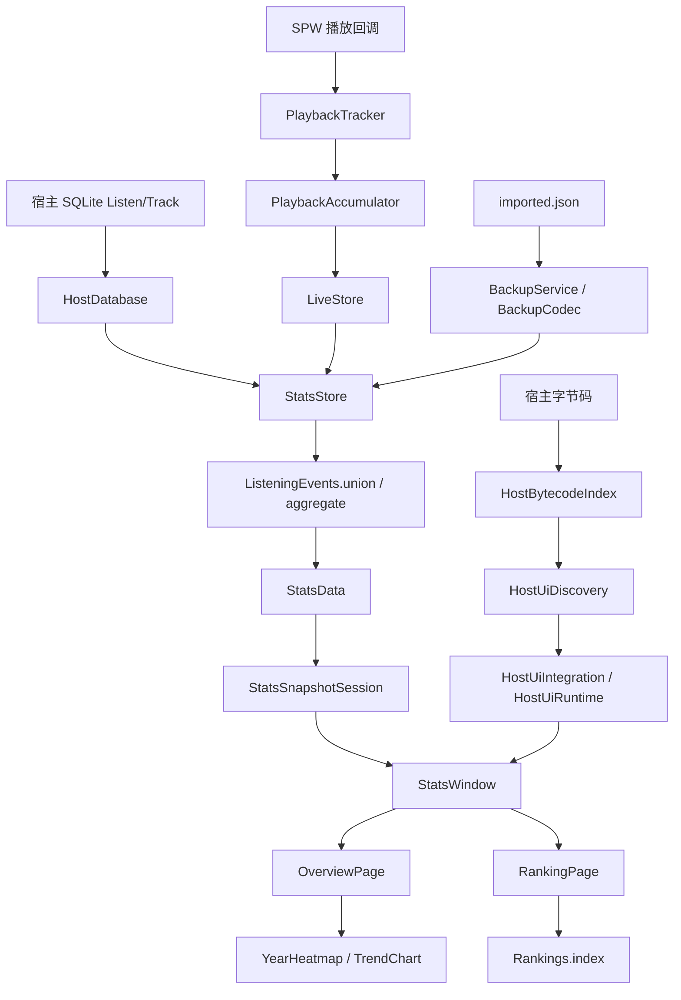

# SPW-Listen-Stats 技术架构参考

本文是 `SPW-Listen-Stats` 的代码级架构参考，供新的 AI 对话、代码审查和 Bug 修复使用。它补充 `docs/AI_MAINTENANCE.md`，重点说明后端数据链路、持久化、宿主 Hook、前端页面、线程模型和故障分流。

本文描述的是当前源码结构和已确认需求。若源码、`docs/REQUIREMENTS.md`、用户当前指令和本文不一致，优先级如下：用户当前指令、根目录 `AGENTS.md`、`docs/REQUIREMENTS.md`、当前源码、本文、历史发布说明。

## 架构总览



系统可以分成四层：

1. **记录层**：接收播放回调，生成精确实时片段并持久化。
2. **读取和合并层**：读取宿主历史、实时会话和导入备份，统一成 `StatsData`。
3. **展示状态层**：管理启用会话快照、刷新、偏好、排行索引和失败保留。
4. **宿主接入与 UI 层**：发现宿主结构、安装 Hook，并在内容层绘制统计页面。

## 启动、停用和线程模型

### 启动

`MainPlugin.start()` 负责：

1. 保存插件路径、插件 ID、SPW 版本和插件版本到 `PluginState`。
2. 初始化 `StatsStore` 和 `PlaybackTracker`。
3. 关闭旧 Hook，避免重复注册。
4. 启动 `StatsSnapshots` 预读当前统计快照和偏好。
5. 创建 `HostUiIntegration`，在后台发现宿主结构。
6. 发现成功后切换到 UI 事件队列，注册页面、导航、转场、隔离层和可选标题栏 Hook。

字节码扫描不应在宿主 Compose/UI 线程执行。`HostUiIntegration` 使用单线程后台执行器；安装和释放 Hook 在事件队列上完成。停用时取消扫描，过期扫描结果不得继续安装 Hook。

### 停用

`MainPlugin.stop()` 会：

- 释放宿主 Hook；
- 关闭 `StatsSnapshots` 和宿主数据库连接；
- 停止 `PlaybackTracker`；
- 关闭统计页状态；
- 清理封面缓存。

释放流程必须允许单个 Hook 关闭失败后继续清理，但在“安装失败后重试”场景不能忽略回滚失败，否则可能留下重复 Hook。

### 调度器和线程归属

| 工作 | 线程/调度器 | 约束 |
|---|---|---|
| 播放回调串行化 | `PlaybackTracker` 自有单线程执行器 | 生成代数，拒绝停用后的旧任务 |
| 宿主字节码扫描 | `HostUiIntegration` 单线程执行器 | 不等待扫描完成即可停用 |
| SQLite 和统计合并 | `Dispatchers.IO` / 调用方后台线程 | 不阻塞 Compose/UI |
| 排行索引 | `Dispatchers.Default` | 搜索只过滤已生成索引 |
| 文件选择框 | 独立 Swing 对话框线程 | 不阻塞宿主 AWT/Compose 事件循环 |
| Hook 安装和释放 | AWT `EventQueue` | 使用宿主要求的 UI 线程 |
| Compose 状态和绘制 | 宿主 Compose/UI 线程 | 只消费已准备好的快照 |

## 后端数据模型和链路

### `PlaybackTracker` 和 `PlaybackAccumulator`

`PlaybackTracker` 接收播放状态、换曲、拖动、位置更新和当前媒体信息。`PlaybackAccumulator` 使用单调时钟计算实际经过的播放时间，再结合位置前进判断是否是有效收听。

关键规则：

- 暂停和停止不填补中间空档。
- 拖动和异常位置跳变不能伪造收听时长。
- 同一遍播放最多计一次有效播放。
- 自动循环和从头重新播放创建新的播放生命周期。
- 播放器没有可用当前状态查询时，只能使用启用后观察到的合理位置建立基线。
- 未知歌曲时长可以记录时间，但不能猜测 50% 播放次数。

`PlaybackTracker.persistSession()` 将变更写入 `LiveStore`。周期性保存仍可能重写完整实时文件；不要在未测量和未验证迁移的情况下改变文件结构。

### `LiveStore`

`LiveStore` 是内存中的 `LinkedHashMap<String, LiveSession>`，同时负责：

- 读取和保存 `live-sessions.json`；
- 保存精确 `spans`、会话生命周期和播放位置；
- 维护宿主行 `hostId`、别名和被拒绝关联；
- 在统计刷新时把实时会话和宿主历史尝试关联；
- 在备份导入前过滤已经被本机否定的关联。

当前文件版本是 v2。v1 读取时会转成近似会话，不能把旧 v1 数据宣称为精确去重结果。

P0 实现还维护了 `mutationRevision`。它在实时会话、关联状态、存储错误状态或重新加载时变化，用于判断统计合并缓存是否失效。

### `HostDatabase`

`HostDatabase` 使用会话级只读 SQLite 连接，并保存以下缓存：

- 数据库文件身份；
- `data_version`；
- `rowid` 是否可用；
- 有效 `ListenEntry`；
- 原始行校验信息 `rawRows`；
- 行数、最大 rowid、时长和起始时间汇总；
- 关联歌曲元数据；
- 最近构建的 `StatsData`。

读取流程：

1. 首次读取全量扫描 `Listen`。
2. 后续读取先比较连接级 `PRAGMA data_version`。
3. 无变化时复用已构建的数据对象。
4. 可证明为追加时读取新增 rowid，并检查最近窗口和汇总值。
5. 发现删除、旧行编辑、时间回退、rowid 不连续或并发提交时回退到全量读取。
6. 只查询历史记录实际引用的 `Track` 元数据。

`HostDatabase.buildData()` 会按起始时间排序，按需要计算日／小时分布和宿主侧有效播放次数。`StatsStore` 当前读取时使用 `aggregate = false`，最终统计聚合由 `LiveStore.merge()` 和 `ListeningEvents.aggregate()` 完成。

### `ListeningEvents`

`ListeningEvent` 同时表达宿主近似快照、实时精确片段和导入事件。重要字段：

- `id`：事件身份；
- `aliases`：跨来源或迁移期间的等价身份；
- `spans`：最终用于统计的片段；
- `preciseSpans`：精确观察证据；
- `approximate`：是否包含宿主或估算时长；
- `libraryId`：来源库身份。

`ListeningEvents.union()` 按事件身份合并候选组，选择较长快照作为基准，同时保留精确片段位置。`withApproximateRemainder()` 只把近似差额分布到精确片段未覆盖的宿主区间。

`ListeningEvents.aggregate()` 在 Union 后：

- 解析元数据优先级；
- 按本地日期和小时拆分片段；
- 计算有效播放次数；
- 生成供页面、排行和明细使用的 `StatsData`。

不要把 `StatsData.dailyMillis` 或 `playCounts` 反向当作精确事件身份；它们是聚合结果。

### `BackupService` 和 `BackupCodec`

持久化文件通常位于插件数据目录：

- `live-sessions.json`：实时会话；
- `imported.json`：已导入备份的合并结果；
- `source-id.txt` / `source-id.backup.txt`：本机来源身份；
- `status.log`：诊断信息。

`BackupService` 负责文件选择、覆盖确认、后台读写、日志和导入后刷新。`BackupCodec` 负责版本、校验、编码、解码和旧 v1 汇总兼容。

导入规则：

- 新版会话使用身份和事件片段去重；
- 旧 v1 只保留按小时和次数取较大值的保守结果；
- 导入不能恢复本机已经否定的错误宿主关联；
- 当前曲库元数据优先，备份只补空字段；
- 文件损坏时保留原文件，不能用空数据覆盖历史。

P0 的备份版本指纹使用路径、修改时间、大小和文件身份；导入文件变化会使合并快照失效。

### `StatsStore`、`StatsSnapshots` 和 P0

`StatsStore.load()` 读取宿主数据后调用 `BackupService.mergeWithLive()`。P0 在这一级缓存最终合并后的 `StatsData`，缓存命中条件包括：

- 宿主 `StatsData` 对象仍然是本次启用会话中的同一对象；
- 备份版本没有变化；
- `LiveStore.mutationRevision` 没有变化；
- 宿主、实时和导入事件的歌曲文件可见性指纹没有变化。

缓存命中不会重新运行 `LiveStore.merge()`、`ListeningEvents.union()` 或 `aggregate()`，也不会改变 `loadedAt`，因此排行榜索引可以复用。

`StatsSnapshotSession` 负责：

- 一次启用会话内的最近成功结果；
- 失败时保留最近成功数据并附加错误；
- 首次预读和打开页面时的偏好重读；
- 读取串行化，防止旧结果覆盖新结果。

## 前端和宿主接入

### 宿主结构发现

宿主接入不是注册固定混淆类名，而是：

1. `HostBytecodeIndex` 扫描宿主 class/JAR，只读取字节码，不初始化播放器服务。
2. `HostUiDiscovery` 根据 Compose、Navigation3、调用关系和字段结构定位：
   - 内容容器；
   - Salt Layer；
   - 导航对象和操作；
   - 标题栏入口；
   - 主题和桌面转场。
3. `HostUiBridge` / `HostUiRuntime` 将描述转换为当前类加载器下的反射访问。
4. `HostUiIntegration` 在 UI 线程安装 Hook。

当前需求要求每次启用重新发现宿主结构，不沿用持久化 Hook 目标缓存。缺失、歧义或调用点不唯一时，核心接入必须拒绝安装。

### 页面 Hook 和导航

- `StatsPageHook`：把统计页面组合到宿主内容层。
- `StatsTitlebarEntry`：提供可选标题栏入口；失败时保留配置入口。
- `StatsNavigationHooks`：处理打开、返回、关闭和其他工具页之间的导航保护。
- `StatsHostTransitionHooks`：适配宿主进入、返回和覆盖转场。
- `HostMaterialLayer`：组合宿主材质和 `subBackground` 背景。
- `HostBackButton` / `HostNavigatorBridge`：处理返回优先级、播放器展开和上层弹窗。
- `StatsHostState`：维护统计页可见性、关闭票据、转场状态和宿主内容隔离。

统计页不是宿主原生 NavDisplay 路由，而是在现有内容层中组合。因此不能宣称它拥有完整原生路由生命周期或预测返回能力。直接切到真实宿主页面时，必须让宿主导航链先被接受，再开始统计页覆盖退出。

### Compose 页面结构

`StatsWindow` 是页面外壳，负责：

- 初始快照和刷新循环；
- 概览／排行页面切换；
- 页面动画开关和退出状态；
- 备份菜单；
- 日期范围、排行榜模式和搜索状态；
- 失败时保留上一次成功数据。

概览页主要由：

- `OverviewPage`：累计统计、热力图、时长分布和明细入口；
- `YearHeatmap`：每日／每周热力图、年份和范围联动；
- `TrendChart`：柱状、折线和平滑曲线；
- `ListeningDetailsPanel`：按时间段展示歌曲明细；
- `DateRangeDialog`：日期范围选择。

排行页主要由：

- `RankingPage`：歌曲、歌手、专辑排行、搜索和分页；
- `Rankings.index()`：后台生成排序和分组索引；
- `CoverStore`：按需加载封面。

公共 UI 和主题：

- `Theme.kt` / `Components.kt` / `Shapes.kt` / `StatsText.kt`：颜色、字体、卡片和控件；
- `PageMotion.kt`：内部页面和主体切换动画；
- `StatsOverlay.kt` / `StatsPlaceholder.kt`：覆盖层、错误和空状态；
- `HostAppearance.kt` / `HostFont.kt`：宿主外观和字体读取；
- `Drawing.kt` / `UiGeometry.kt`：图表、热力图和尺寸计算。

刷新时页面应保留滚动位置、筛选、分页和已展开明细。普通刷新不能重播整页或热力图入场动画。进入、返回和直接切页的转场方向必须遵循 `docs/REQUIREMENTS.md`，不能仅凭截图猜测。

## Bug 分流

| 症状 | 首先检查 | 常见边界 |
|---|---|---|
| 没有记录播放 | `PlaybackTracker`、`PlaybackAccumulator`、权限 | 启用前时段不能补算，位置回调可能缺失 |
| 时长跨日错误 | `TimeSplitter`、`ListeningEvents.aggregate` | DST、跨小时、跨自然日 |
| 播放次数错误 | `PlaybackAccumulator`、`ListeningEvents.aggregate` | 50% 阈值、循环、拖动、未知时长 |
| 实时和宿主重复累计 | `LiveStore.merge`、`ListeningEvents.union` | hostId、aliases、rejectedHostIds、来源身份 |
| 导入重复或少计 | `BackupService`、`BackupCodec`、`LiveStore.correctImportedEvents` | v1/v2、校验、旧拒绝关联 |
| 导入/导出点击卡死 | `BackupService` 对话框线程、协程异常日志 | 不能在 Compose/AWT 事件循环中阻塞 |
| 宿主新增记录后刷新很慢 | `LiveStore.merge`、`ListeningEvents.union` / `aggregate`、`HostDatabase.refreshChanged` | P0-A 已消除 `sourceId()` 按历史记录重复调用；剩余热点需以当前埋点复测 |
| 页面入口失效 | `HostBytecodeIndex`、`HostUiDiscovery`、权限 | 宿主版本、歧义、调用点数量 |
| 页面能开但返回异常 | `StatsNavigationHooks`、`StatsHostState`、`HostBackButton` | 弹窗、播放器展开、其他插件离开保护 |
| 页面动画或材质错误 | `PageMotion`、`StatsHostTransitionHooks`、`HostMaterialLayer` | 真实 DWM 和多插件仍需实机验证 |
| 排行搜索或分页错误 | `Rankings`、`RankingPage` | 索引排名必须先于分页，搜索不能重建完整历史 |
| 封面异常 | `CoverStore`、来源身份 | LRU、并发请求合并、失败冷却、异库 ID |

处理新 Bug 时先确定它属于哪条链路，再收集最小证据：日志、数据快照、宿主版本、权限状态、是否发生导入／播放／导航变化。不要直接在多个层同时重写逻辑。

## 测试和验证

常用测试入口：

```powershell
py -3.12 tests/run-data-tests.py data
py -3.12 tests/run-data-tests.py host
py -3.12 tests/run-data-tests.py cache
py -3.12 tests/run-data-tests.py analysis
```

其他 suite 可在 `tests/run-data-tests.py` 中查到，包括完整性、排行、热力图、导航、覆盖图和审查修复回归。

验证边界：

- 合成数据回归不能替代真实 SPW 播放、权限、窗口材质和多插件验收。
- 离屏 UI 检查不能证明 DWM、AOT 或宿主实际注入成功。
- 性能基准不读取个人听歌历史，且当前单曲合成形状不能代表所有歌曲分布。
- 任何宣称“已修复”的结论都应说明测试场景和未覆盖场景。

## 维护原则

- 不改统计口径来换取性能数字。
- 不把缓存命中、静态 Hook 检查或离屏渲染结果写成实机兼容性。
- 不在没有基准和回归证明时实现大规模增量聚合。
- 不把累计分配量误称为内存占用。
- 不清理用户未提交修改，不提交 SPW 安装文件、真实历史、私有备份或构建缓存。
- 任何需求变更都应同步更新 `docs/REQUIREMENTS.md`；构建和使用说明更新 `plugin/README.md`，但不要擅自修改根目录 `README.md`。
