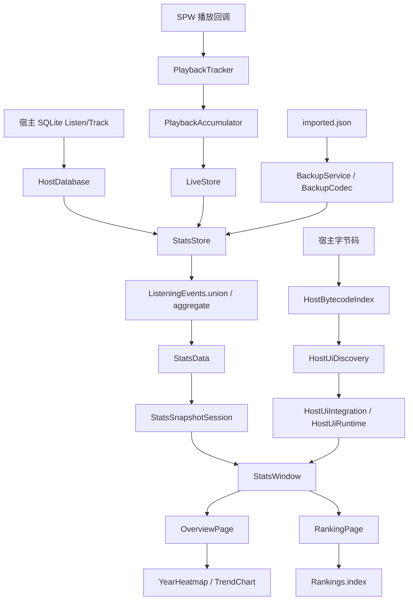

# SPW-Listen-Stats 技术架构参考

本文是 `SPW-Listen-Stats` 的代码级架构参考，供新的 AI 对话、代码审查和 Bug 修复使用。它补充 `docs/AI_MAINTENANCE.md`，重点说明后端数据链路、持久化、宿主 Hook、前端页面、线程模型和故障分流。

本文描述的是当前源码结构和已确认需求。若源码、`docs/REQUIREMENTS.md`、用户当前指令和本文不一致，优先级如下：用户当前指令、根目录 `AGENTS.md`、`docs/REQUIREMENTS.md`、当前源码、本文、历史发布说明。

## 架构总览



系统可以分成四层：

1. **记录层**：接收播放回调，生成精确实时片段并持久化。
2. **读取和合并层**：读取宿主历史、实时会话和导入备份，统一成 `StatsData`。
3. **展示状态层**：管理启用会话快照、刷新、偏好、排行索引和失败保留。
4. **宿主接入与 UI 层**：发现宿主结构、安装 Hook，并在内容层绘制统计页面。

## 启动、停用和线程模型

### 启动

`MainPlugin.start()` 负责：

1. 保存插件路径、插件 ID、SPW 版本和插件版本到 `PluginState`。
2. 初始化 `StatsStore` 和 `PlaybackTracker`。
3. 关闭旧 Hook，避免重复注册。
4. 启动 `StatsSnapshots` 预读当前统计快照和偏好。
   同时启动 `Updates` 的后台调度；自动联网须等待约 30 秒，并满足提醒开关与 24 小时间隔。
5. 创建 `HostUiIntegration`，在后台校验持久化目标缓存，未命中时发现宿主结构。
6. 发现成功后切换到 UI 事件队列，注册页面、导航、转场、隔离层和可选标题栏 Hook。

字节码扫描不应在宿主 Compose/UI 线程执行。`HostUiIntegration` 使用单线程后台执行器；安装和释放 Hook 在事件队列上完成。停用时取消扫描，过期扫描结果不得继续安装 Hook。

### 停用

`MainPlugin.stop()` 会：

- 释放宿主 Hook；
- 关闭 `StatsSnapshots` 和宿主数据库连接；
- 取消 `Updates` 后台任务，过期检查结果和提醒回调不得作用于新一次启用；
- 停止 `PlaybackTracker`；
- 关闭统计页状态；
- 清理封面缓存。

释放流程必须允许单个 Hook 关闭失败后继续清理，但在“安装失败后重试”场景不能忽略回滚失败，否则可能留下重复 Hook。

### 调度器和线程归属

| 工作 | 线程/调度器 | 约束 |
|---|---|---|
| 播放回调串行化 | `PlaybackTracker` 自有单线程执行器 | 生成代数，拒绝停用后的旧任务 |
| 宿主字节码扫描 | `HostUiIntegration` 单线程执行器 | 不等待扫描完成即可停用 |
| SQLite 和统计合并 | `Dispatchers.IO` / 调用方后台线程 | 不阻塞 Compose/UI |
| 排行索引 | `Dispatchers.Default` | 搜索只过滤已生成索引 |
| 文件选择框 | 独立 Swing 对话框线程 | 不阻塞宿主 AWT/Compose 事件循环 |
| Hook 安装和释放 | AWT `EventQueue` | 使用宿主要求的 UI 线程 |
| Compose 状态和绘制 | 宿主 Compose/UI 线程 | 只消费已准备好的快照 |

## 后端数据模型和链路

### `PlaybackTracker` 和 `PlaybackAccumulator`

`PlaybackTracker` 接收播放状态、换曲、拖动、位置更新和当前媒体信息。`PlaybackAccumulator` 使用单调时钟计算实际经过的播放时间，再结合位置前进判断是否是有效收听。

关键规则：

- 暂停和停止不填补中间空档。
- 拖动和异常位置跳变不能伪造收听时长。
- 同一遍播放最多计一次有效播放。
- 自动循环和从头重新播放创建新的播放生命周期。
- 播放器没有可用当前状态查询时，只能使用启用后观察到的合理位置建立基线。
- 未知歌曲时长可以记录时间，但不能猜测 50% 播放次数。

`PlaybackTracker.persistSession()` 将变更写入 `LiveStore`。周期性保存仍可能重写完整实时文件；不要在未测量和未验证迁移的情况下改变文件结构。

### `LiveStore`

`LiveStore` 是内存中的 `LinkedHashMap<String, LiveSession>`，同时负责：

- 读取和保存 `live-sessions.json`；
- 保存精确 `spans`、会话生命周期和播放位置；
- 维护宿主行 `hostId`、别名和被拒绝关联；
- 在统计刷新时把实时会话和宿主历史尝试关联；
- 在备份导入前过滤已经被本机否定的关联。

当前文件版本是 v2。v1 读取时会转成近似会话，不能把旧 v1 数据宣称为精确去重结果。

P0 实现还维护了 `mutationRevision`。它在实时会话、关联状态、存储错误状态或重新加载时变化，用于判断统计合并缓存是否失效。

### `HostDatabase`

`HostDatabase` 使用会话级只读 SQLite 连接，并保存以下缓存：

- 数据库文件身份；
- `data_version`；
- `rowid` 是否可用；
- 有效 `ListenEntry`；
- 原始行校验信息 `rawRows`；
- 行数、最大 rowid、时长和起始时间汇总；
- 关联歌曲元数据；
- 最近构建的 `StatsData`。

读取流程：

1. 首次读取全量扫描 `Listen`。
2. 后续读取先比较连接级 `PRAGMA data_version`。
3. 无变化时复用已构建的数据对象。
4. 可证明为追加时读取新增 rowid，并检查最近窗口和汇总值。
5. 发现删除、旧行编辑、时间回退、rowid 不连续或并发提交时回退到全量读取。
6. 只查询历史记录实际引用的 `Track` 元数据。

`HostDatabase.buildData()` 会按起始时间排序，按需要计算日／小时分布和宿主侧有效播放次数。`StatsStore` 当前读取时使用 `aggregate = false`，最终统计聚合由 `LiveStore.merge()` 和 `ListeningEvents.aggregate()` 完成。

### `ListeningEvents`

`ListeningEvent` 同时表达宿主近似快照、实时精确片段和导入事件。重要字段：

- `id`：事件身份；
- `aliases`：跨来源或迁移期间的等价身份；
- `spans`：最终用于统计的片段；
- `preciseSpans`：精确观察证据；
- `approximate`：是否包含宿主或估算时长；
- `libraryId`：来源库身份。

`ListeningEvents.union()` 按事件身份合并候选组，选择较长快照作为基准，同时保留精确片段位置。`withApproximateRemainder()` 只把近似差额分布到精确片段未覆盖的宿主区间。

`ListeningEvents.aggregate()` 在 Union 后：

- 解析元数据优先级；
- 按本地日期和小时拆分片段；
- 计算有效播放次数；
- 生成供页面、排行和明细使用的 `StatsData`。

不要把 `StatsData.dailyMillis` 或 `playCounts` 反向当作精确事件身份；它们是聚合结果。

### `BackupService` 和 `BackupCodec`

持久化文件通常位于插件数据目录：

- `live-sessions.json`：实时会话；
- `imported.json`：已导入备份的合并结果；
- `source-id.txt` / `source-id.backup.txt`：本机来源身份；
- `status.log`：诊断信息。

`BackupService` 负责文件选择、覆盖确认、后台读写、日志和导入后刷新。`BackupCodec` 负责版本、校验、编码、解码和旧 v1 汇总兼容。

导入规则：

- 新版会话使用身份和事件片段去重；
- 旧 v1 只保留按小时和次数取较大值的保守结果；
- 导入不能恢复本机已经否定的错误宿主关联；
- 当前曲库元数据优先，备份只补空字段；
- 文件损坏时保留原文件，不能用空数据覆盖历史。

P0 的备份版本指纹使用路径、修改时间、大小和文件身份；导入文件变化会使合并快照失效。

### `StatsStore`、`StatsSnapshots` 和 P0

`StatsStore.load()` 读取宿主数据后调用 `BackupService.mergeWithLive()`。P0 在这一级缓存最终合并后的 `StatsData`，缓存命中条件包括：

- 宿主 `StatsData` 对象仍然是本次启用会话中的同一对象；
- 备份版本没有变化；
- `LiveStore.mutationRevision` 没有变化；
- 宿主、实时和导入事件的歌曲文件可见性指纹没有变化。

缓存命中不会重新运行 `LiveStore.merge()`、`ListeningEvents.union()` 或 `aggregate()`，也不会改变 `loadedAt`，因此排行榜索引可以复用。

`StatsSnapshotSession` 负责：

- 一次启用会话内的最近成功结果；
- 失败时保留最近成功数据并附加错误；
- 首次预读和打开页面时的偏好重读；
- 读取串行化，防止旧结果覆盖新结果。

## 前端和宿主接入

### 宿主结构发现

宿主接入不是注册固定混淆类名，而是：

1. `HostBytecodeIndex` 扫描宿主 class/JAR，只读取字节码，不初始化播放器服务。
2. `HostUiDiscovery` 根据 Compose、Navigation3、调用关系和字段结构定位：
   - 内容容器；
   - Salt Layer；
   - 导航对象和操作；
   - 标题栏入口；
   - 主题和桌面转场。
3. `HostUiBridge` / `HostUiRuntime` 将描述转换为当前类加载器下的反射访问。
4. `HostUiIntegration` 在 UI 线程安装 Hook。

Issue #7 已授权引入 `HostTargetCache`：仅保存方法、字段及调用位置描述，匹配真实路径、宿主全文件 SHA-256、插件版本及格式版本；目录形式继续扫描。命中后仍为每次启用创建全新的 `HostUiBridge` 并在后台准备反射。完整发现、反射准备和注册成功后才能后台写临时文件，通过会话锁校验代数后原子发布到数据目录 `host-targets-v1.json`，不缓存可选标题栏／主题降级结果。旧任务不能注册或覆盖缓存。

缓存损坏／失效／反射失败回退完整扫描；缓存注册失败或可选注册不完整时，`HookHandles` 逆序尽力回滚，只有每个句柄均成功释放才允许全扫描并重试一次。任一内层回滚失败即停止，将残留所有权向上传递并阻止再次注册；显式停用仍可再次尝试释放。取消、停用、权限不足不重试。关闭失败向上抛出，不清空残留句柄、不另排异步重复释放。全扫描仍保留标题栏和主题降级。缺失、歧义或调用点不唯一时，核心接入必须拒绝安装。缓存原子写失败仅记诊断，不撤销成功接入。

普通诊断记录 `cache_validate_ms`（真实路径、内容摘要与缓存解析匹配）、`scan_ms`（字节码读取与结构发现）、`prepare_ms`、`install_ms` 和从启用开始计的 `ready_ms`。测试假注册器的时间只表示离线流程耗时，真实入口就绪需 SPW 安装验收。

### 页面 Hook 和导航

- `StatsPageHook`：把统计页面组合到宿主内容层。
- `StatsTitlebarEntry`：提供可选标题栏入口；失败时保留配置入口。
- `StatsNavigationHooks`：处理打开、返回、关闭和其他工具页之间的导航保护。
- `StatsHostTransitionHooks`：适配宿主进入、返回和覆盖转场。
- `HostMaterialLayer`：组合宿主材质和 `subBackground` 背景。
- `HostBackButton` / `HostNavigatorBridge`：处理返回优先级、播放器展开和上层弹窗。

`StatsNavigationHooks` 另保留本次启用的一条前进恢复记录：明确返回关闭统计时记录当前 Binding、宿主页对象身份和宿主前进项快照；`HostUiBridge.forwardHistory()` 仅在 Navigator 声明的非静态 java.util.List 字段唯一且可访问时读取副本，不写栈，不缓存这个运行期列表。前进到原位置并且宿主前进项身份／顺序均匹配时，消费插件这一层虚拟前进步骤，仍经 `StatsSnapshots.prepareOpen` 和 priority-80 等离开保护后由 priority-50 请求确认打开；进入时清除恢复记录。宿主进一步回退／前进、播放器前进项保持原顺序，新接受的 navigate／replace、强制关闭、停用和重新绑定清除记录。动画关闭时仅重置可见性，不能把一次正常返回误当强制清理而丢掉恢复记录；旧退出 ticket 不影响恢复。前进无操作通过路由、上层覆盖和前进快照共同判断，不能仅凭 forward 方法返回就关闭统计。范围限制与实机状态见 REQUIREMENTS；回归入口 NavigationRegressionTest 的 checkStatisticsForwardRestore。
- `StatsHostState`：维护统计页可见性、关闭票据、转场状态和宿主内容隔离。

统计页不是宿主原生 NavDisplay 路由，而是在现有内容层中组合。因此不能宣称它拥有完整原生路由生命周期或预测返回能力。直接切到真实宿主页面时，必须让宿主导航链先被接受，再开始统计页覆盖退出。

### Compose 页面结构

`StatsWindow` 是页面外壳，负责：

- 初始快照和刷新循环；
- 概览／排行页面切换；
- 页面动画开关和退出状态；
- 备份菜单；
- 日期范围、排行榜模式和搜索状态；
- 失败时保留上一次成功数据。

概览页主要由：

- `OverviewPage`：累计统计、热力图、时长分布和明细入口；
- `YearHeatmap`：每日／每周热力图、年份和范围联动；
- `TrendChart`：柱状、折线和平滑曲线；
- `ListeningDetailsPanel`：按时间段展示歌曲明细；
- `DateRangeDialog`：日期范围选择。

排行页主要由：

- `RankingPage`：歌曲、歌手、专辑排行、搜索和分页；
- `Rankings.index()`：后台生成排序和分组索引；
- `CoverStore`：按需加载封面。

歌曲行通过 `detectTapGestures(onDoubleTap)` 触发单曲播放，单击和艺术家／专辑行不播放。`HostSongPlayback` 用公开 `library.getTrackById` 重新查询当前歌曲，后台检查文件与反射结构，再在主线程依次调用内部 `PlaybackController.addToPlay(PiscesMediaItem)`、`prepare()`、`play()`，与 SPW 1.19.3 原生歌曲动作一致；这组命令由宿主管理单曲与队列，不传整个排行榜，不自行写统计。内部六字符串构造器按 Kotlin 元数据校验字段顺序，未知结构拒绝播放；不将反射目标写入 Hook 缓存。重复请求取消前一协程，提交时复核启用会话和行是否仍有效，停用／退出后的异步结果不能播放。公开 API 的 `play()` 只能继续当前歌曲，不能代替此接口。当前仅对本地 SPW 1.19.3 做静态核对，开发包实机验收需覆盖双击、切页／停用、失效文件和队列行为。

相关验证入口为 `tests/check-song-playback.py`：编译后执行 14 项播放／手势回归及既有 8 组排行回归，使用合成元数据和离屏鼠标事件；生产异步查询／主线程提交链使用拒绝权限的替身阻断真实播放；另用只隔离两类的子优先 ClassLoader 让真实反射适配器执行至合成播放控制器，校验歌曲六字段、`addToPlay → prepare → play` 顺序及准备失败不继续／不重试。dev.1 的测试只验证到权限拦截，遗漏最终命令，实机出现歌曲已切换但音频未启动；不得把这类替身测试写成真实音频已验收。构建不会覆盖既有包，检查既有安装包摘要保持不变。该验证不能代替真实播放与队列验收。

`DurationColumns.kt` 为中文与英文排行和歌曲明细提供共享的时／分／秒列宽：父表按可见数据最长小时位数、当前继承字体与字号测量一次，分秒固定两位，子行共用该布局，各段零额外间距，时长文本也不插入单位间空格；表头通过同一指标宽度右对齐。`durationTableParts` 只负责表格文案，不改变普通时长格式函数；零值与不足一秒单独保留，数据精度不变。语言选择进入列宽缓存键，按“小时／分／秒”或“h/m/s”分别测量单位宽度，两个语言分支必须同时接入；不足一秒的完整提示占用整组宽度，不放大普通秒字段。明细独立启用 `omitZeroMinutes`，表内与合计使用同一 `DurationColumns`，列宽上限同时考虑合计；零分钟隐藏，父容器靠右，空字段不保留内部空隙，其他分钟／秒字段使用共用宽度。排行榜不启用省略零分钟。表格宽度按需扩展以容纳长小时数；保留自定义字体，优先使用等宽数字特性，同时按最宽数字预留回退宽度。

公共 UI 和主题：

`DisplayPreferences` 的 `overviewLatinDurationUnits` 与 `detailLatinDurationUnits` 是独立的布尔配置，缺失／类型错误均回退 false。由既有后台偏好读取、快照交接与刷新路径更新，OverviewPage 将前者传给累计／小结、YearHeatmap、TrendChart；后者传给 ListeningDetailsExpansion，StatsWindow 同时将后者传给 RankingPage。`util/Format.kt` 的纯格式函数接收显式单位参数，默认保留中文；只替换 h/m/s 单位，不改变分钟舍入或完整秒截断。图表和热力图 tooltip 的 remember 键包含单位选择，避免显示旧格式；该设置不进入曲线几何／静态像素缓存的键，不重建排行索引。相关轻量检查见时长格式与配置读取回归。

- `Theme.kt` / `Components.kt` / `Shapes.kt` / `StatsText.kt`：颜色、字体、卡片和控件；
- `PageMotion.kt`：内部页面和主体切换动画；
- `StatsOverlay.kt` / `StatsPlaceholder.kt`：覆盖层、错误和空状态；
- `HostAppearance.kt` / `HostFont.kt`：宿主外观和字体读取；
- `Drawing.kt` / `UiGeometry.kt`：图表、热力图和尺寸计算。

`TrendChart.kt` 在 `remember` 中缓存完整点集、主路径和填充路径，键包括数据、图表类型、解析后的绘图区边界、纵轴单位／最大值及密度。路径构建保持原有插值，发布后不再修改 Path。`drawBase` 只使用静态输入，曲线／折线在首次绘制时把完整静态层光栅化为当前设备像素尺寸的透明 `ImageBitmap`，由稳定 Modifier 和独立 `graphicsLayer` 复用；仅记录路径的图层仍可能重复栅格化，不能据静态回调次数归零推断整体收益。像素缓存不改采样点数，`drawMarker` 读取悬停／选中状态并更新动态层，提示仍走原有 Popup。主题／字体／平均线、布局方向等绘制样式单独使静态层失效；像素缓存只保留当前图表的一份，随几何／样式键替换，离开组合后丢弃引用；指针、选中索引和滚动提示修订不进入几何键。柱状图继续使用原有顺序整体绘制，以保持圆角透明边缘。验证入口 `tests/check-trend-chart-cache.py` 对比不可覆盖的 dev.11 包，探针仅作用于测试字节码副本；整体耗时来自无探针运行，范围仅限本图表。

刷新时页面应保留滚动位置、筛选、分页和已展开明细。普通刷新不能重播整页或热力图入场动画。进入、返回和直接切页的转场方向必须遵循 `docs/REQUIREMENTS.md`，不能仅凭截图猜测。

### 关于与更新提醒

`AboutDialog.kt` 在“关于听歌统计”标题与版本号下使用两行紧凑信息布局：第一行“作者  Jethuit”，第二行并排展示项目主页／问题反馈／开源许可文字链接，使用透明背景和主题强调色，不绘制灰色卡片或边框，不加入插件简介。随后展示可保存的“为微软商店版启用更新提醒”开关、更新结果、手动检查与发布页入口。弹窗沿用 480dp 最大宽度，高度随内容调整，小窗口继续滚动。三个链接分别打开项目仓库、Issues 和根目录 LICENSE，与发布页共用后台浏览器打开及错误提示。`Prefs` 沿用 `microsoftStoreEdition` 配置键保留上一开发版的选择，该值现用于控制提醒，不用于检测安装渠道。宿主配置和关于弹窗共用此值。

`updates/GitHubRelease.kt` 负责公开 GitHub 最新正式 Release 的请求、响应校验与 SemVer 比较；宿主裁剪运行时没有 `java.net.http` 模块，因此使用 `java.base` 的连接 API。`UpdateChecker.kt` 串行检查并保存 `update-check.json` 中的尝试时间、成功结果和已提醒版本；`Updates.kt` 管理启停、后台调度与宿主轻提示。自动失败静默，手动失败显示在弹窗内；不读取听歌记录，不查询渠道内部接口，不自动下载安装。合成检查入口为 `tests/run-data-tests.py updates`。

## Bug 分流

| 症状 | 首先检查 | 常见边界 |
|---|---|---|
| 没有记录播放 | `PlaybackTracker`、`PlaybackAccumulator`、权限 | 启用前时段不能补算，位置回调可能缺失 |
| 时长跨日错误 | `TimeSplitter`、`ListeningEvents.aggregate` | DST、跨小时、跨自然日 |
| 播放次数错误 | `PlaybackAccumulator`、`ListeningEvents.aggregate` | 50% 阈值、循环、拖动、未知时长 |
| 实时和宿主重复累计 | `LiveStore.merge`、`ListeningEvents.union` | hostId、aliases、rejectedHostIds、来源身份 |
| 导入重复或少计 | `BackupService`、`BackupCodec`、`LiveStore.correctImportedEvents` | v1/v2、校验、旧拒绝关联 |
| 导入/导出点击卡死 | `BackupService` 对话框线程、协程异常日志 | 不能在 Compose/AWT 事件循环中阻塞 |
| 宿主新增记录后刷新很慢 | `LiveStore.merge`、`ListeningEvents.union` / `aggregate`、`HostDatabase.refreshChanged` | P0-A 已消除 `sourceId()` 按历史记录重复调用；剩余热点需以当前埋点复测 |
| 页面入口失效 | `HostBytecodeIndex`、`HostUiDiscovery`、权限 | 宿主版本、歧义、调用点数量 |
| 页面能开但返回异常 | `StatsNavigationHooks`、`StatsHostState`、`HostBackButton` | 弹窗、播放器展开、其他插件离开保护 |
| 页面动画或材质错误 | `PageMotion`、`StatsHostTransitionHooks`、`HostMaterialLayer` | 真实 DWM 和多插件仍需实机验证 |
| 排行搜索或分页错误 | `Rankings`、`RankingPage` | 索引排名必须先于分页，搜索不能重建完整历史 |
| 封面异常 | `CoverStore`、来源身份 | LRU、并发请求合并、失败冷却、异库 ID |
| 更新提示或版本比较异常 | `AboutDialog`、`updates/`、`Prefs` | 自动/手动失败区别、开发版与正式版、24 小时节流、停用取消及同版本提醒去重 |

处理新 Bug 时先确定它属于哪条链路，再收集最小证据：日志、数据快照、宿主版本、权限状态、是否发生导入／播放／导航变化。不要直接在多个层同时重写逻辑。

## 测试和验证

常用测试入口：

```powershell
py -3.12 tests/run-data-tests.py data
py -3.12 tests/run-data-tests.py host
py -3.12 tests/run-data-tests.py cache
py -3.12 tests/run-data-tests.py analysis
```

其他 suite 可在 `tests/run-data-tests.py` 中查到，包括完整性、排行、热力图、导航、覆盖图和审查修复回归。

验证边界：

- 合成数据回归不能替代真实 SPW 播放、权限、窗口材质和多插件验收。
- 离屏 UI 检查不能证明 DWM、AOT 或宿主实际注入成功。
- 性能基准不读取个人听歌历史，且当前单曲合成形状不能代表所有歌曲分布。
- 任何宣称“已修复”的结论都应说明测试场景和未覆盖场景。

## 维护原则

- 不改统计口径来换取性能数字。
- 不把缓存命中、静态 Hook 检查或离屏渲染结果写成实机兼容性。
- 不在没有基准和回归证明时实现大规模增量聚合。
- 不把累计分配量误称为内存占用。
- 不清理用户未提交修改，不提交 SPW 安装文件、真实历史、私有备份或构建缓存。
- 任何需求变更都应同步更新 `docs/REQUIREMENTS.md`；构建和使用说明更新 `plugin/README.md`，但不要擅自修改根目录 `README.md`。
