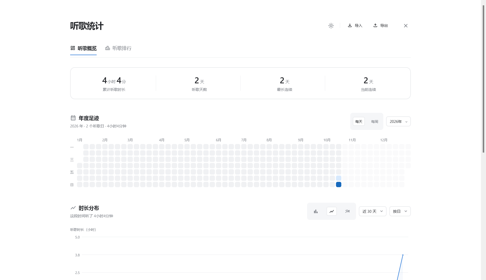

# 正式模组实现说明

更新时间：2026-10-18。当前源码版本 0.1.15；视觉基准仍为 `preview/`。0.1.5 将统计页内嵌到宿主内容区，移除独立窗口/浮动入口，并打包 SaltUI 3.0.0-beta02（宿主 Salt UI 3.0.0-SNAPSHOT / CMP 1.12.1）。0.1.15 让主题跟随宿主 SPW，而不是直接跟随系统。



## 构建和安装

```powershell
python tools/prepare_toolchain.py --spw-dir "E:\SteamLibrary\steamapps\common\Salt Player for Windows"
python tools/build_plugin.py --spw-dir "E:\SteamLibrary\steamapps\common\Salt Player for Windows"
```

产物 `build/libs/plugin-com.jethuit.spw.listenstats-0.1.15.spmod`。在 SPW 创意工坊“本地导入”，启用并授权 `library-read` 和 `class-transform`。使用宿主 1.19.0 的 fat jar 作编译类路径；JDK 25 / Kotlin 2.4.20 / sqlite-jdbc / SaltUI 3.0.0-beta02 与宿主包缓存在 `build/tools/`，均不提交。

入口只在模块管理页插件配置的“打开听歌统计”。页面通过 `AppNavigation` 的 `afterComposable` hook 注入宿主内容区，不创建 `JDialog` 或 `Popup`；宿主侧栏和底部播放栏保留。当前关闭/返回按钮位于内容区左上角，样式待确认。

## 0.1.15 主题跟随 SPW

- `StatsTheme` 的第一档 `ThemeMode.System` 语义改为“跟随 SPW”，显示文案同步。
- 每秒读取 `com.xuncorp.voxzen.util.AppConfig.lightDarkTheme`：Light/Dark 直接采用，FollowSystem 回退 `readSystemDarkTheme()`；异常也回退系统，不崩溃。
- **未实现背景样式**：宿主 `SpwWindowStyle` 的 Acrylic/Mica/MicaAlt 是 DWM 窗口效果，插件无法创建；只能读取并考虑透明继承或近似，需用户确认。

## 0.1.14 第三页跳转

- 根因：`RankingPage` 25 条/页，但 `StatsWindow` 仍按 50 条/页计算 `safePage`，`rankPage=3` 被夹成 2。
- 统一 `RANKING_PAGE_SIZE=25`、`rankingTotalPages`、`rankingSafePage`，两处共用；删除无用的 `rowsOnPage`。
- UI 回归新增 72 首三页、第三页保留、越界夹末页、25 首单页。

## 0.1.13 底栏/头部/每页数

- 排行底栏去掉末尾“·”和虚线 leader，只保留说明文字和右侧分页组。
- `TextAction` 与主题 `IconAction` 统一 34dp 高、8dp 圆角、19px 图标、`muted` 图标色。
- `RankingPage.PAGE_SIZE = 25`。
- 概览标题“年度足迹”→“听歌热力图”。

## 0.1.12 排行底栏与图注

- 排行页底部单行：说明文字 + 虚线 leader + `‹ 页码 ›` 按钮组；`PageFooter` 仅在概览页显示。
- 分页组 `subtle` 背景 8dp，内部按钮 5dp、28dp 高，无描边；上一页/下一页用 `‹`/`›`。
- 搜索框无描边、`subtle` 背景、8dp 圆角；`TextAction`/`IconAction` 统一 8dp。
- `SectionHeading` 桌面分支用 `heightIn(min=headingHeight)`，允许图注自然撑高，不再被 42dp 裁切。

## 0.1.11 标题字号与圆角

- `SectionHeading` 增加 `titleStyle` 参数；排行页标题使用 18sp/24sp 行高（原 16sp）。
- `SegmentedControl` 外框和 `SelectBox` 统一 `AppShape(8.dp)`；内部 active 按钮仍 5dp。
- 控件高度 34dp、排行标题行 34dp、导航下 18dp 留白继续保留。

## 0.1.10 控件等高与留白

- `SegmentedControl` 外层固定 34dp（内边距 3dp，选项高 28dp）；`SelectBox` 固定 34dp，内容垂直居中。
- 排行页 `SectionHeading` 高度 34dp；`PageNav` 在排行页下方间距 18dp（概览仍 30dp）。
- 图表类型 tooltip 已在 0.1.9 删除，本次保留。

## 0.1.9 提示块与标题行

- `SegmentedControl` 的 `HoverColor` 不再传 visual tooltip；图表类型按钮仍保留 `contentDescription`，但不会显示黑色提示块。
- `SectionHeading` 的桌面分支改为固定 42dp 高，标题和操作区分别在 `CenterStart`/`CenterEnd` 内上下居中；排行页标题/搜索/摘要所在行不再偏上。
- 0.1.8 的顶部单分页、播放次数固定 96dp 居中、封面重试、宿主字体等继续保留。

## 0.1.8 排行榜/封面/字体

- 排行分页只保留列表底部，顶部页码删除。
- 播放次数列固定 96dp，表头与数值居中；其余宽度按 56%/44% 分配。
- `CoverStore` 不再缓存 null/失败；失败后 30 秒冷却重试，封面成功才缓存。只使用宿主内嵌封面，无内嵌封面保持占位图。
- 正文继续使用 SaltUI `Text`；`TrendChart`/`YearHeatmap` canvas 文字使用 SaltUI `LocalTextStyle.current.fontFamily`，字号继续用 sp，随宿主字体和缩放。
- 主题按钮删除黑色 tooltip；返回键此前已删除，只保留无障碍名称。

## 0.1.7 选择框去描边

`SelectBox` 不再绘制 1px 边框，只保留 `subtle` 背景和 7dp 圆角，与左侧“每天/每周”、图表类型分组一致。日期范围、年份、粒度下拉都使用同一组件，因此一并去描边。

## 0.1.6 反馈修复

- `SelectBox` 背景改为 `subtle`，与左侧分段控件一致；边框仍保留。
- 已选热力图日再次点击会清除选择并回到 `Last30`；已选周再次点击会清除自定义周范围。
- 纵轴文案改为“时长/h”或“时长/min”；单日 24 小时图固定 4 小时标签步长。
- 内嵌页底部 padding 96dp，避免最后内容被宿主播放栏覆盖。
- 返回箭头改为带横杆路径，并移除悬停 tooltip（`IconAction(tooltip = null)`）。

## 0.1.5 内嵌与 SaltUI

- `MainPlugin.openStats` 设置 `StatsHostState.visible`；`StatsOverlay` 直接在宿主编排中渲染 `ListenStatsApp(embedded = true)`。不再调用 `StatsWindow.open()`，不再创建窗口，也没有 `toFront`/置顶。
- 删除右下角 `Popup` pill；入口只保留模块管理页配置按钮。
- SaltUI 依赖来自 Maven 的 `io.github.moriafly:salt-ui-desktop:3.0.0-beta02` 与 `salt-core-desktop:3.0.0-beta02`；宿主显示 Salt UI 3.0.0-SNAPSHOT、CMP 1.12.1，beta02 对应同一 CMP 线。两个 jar 放入 `.spmod` 的 `lib/`。
- 页面包在 `SaltTheme(configs = saltConfigs(isDark))` 中；滚动使用 SaltUI `rememberScrollState`/`verticalScroll`，文本使用 SaltUI `Text`，概览卡片/错误卡片使用 SaltUI `Card`；热力图、部分按钮/分段控件和固定尺寸仍待迁移。
- 返回按钮位于内容区左上角，使用返回箭头，语义为回到宿主原页面。
- 侧栏/播放栏仍可操作；当前页面不是宿主原生导航路由，hook 目标仍是 1.19.0 的 `androidx.compose.ui.ۄ`。
- 卡片、按钮、文本、热力图等大部分仍是 Material3/自绘实现；SaltUI 目前承担主题与滚动，组件迁移待用户确认。

**验证：** 隔离 APPDATA 中 `embed_proto.png` 显示页面嵌入宿主内容区、无 pill、侧栏/播放栏未遮挡；`embed_scrolled.png` 显示滚轮滚动后图表/小结可见。该验证使用了临时 `spw.listenstats.autotest` 打开页面，提交前已移除；配置页入口点击链路仍需用户验收。

## 0.1.4 布局对齐

按 `preview/styles.css` 和 `preview/app.js` 逐项修正，详见 [UI 修订](UI-FIXES.md)：

- 页面顶部 padding：≥1450dp 为 68dp，>900 为 56dp，>600 为 34dp，其余 26dp；section heading 恢复 42dp 最小高度，控制间距默认 12dp，时长分布 9dp。
- 排行搜索改为 190×34 外框、10dp 内边距、15dp 图标、7dp 间距、148dp 输入区；表格列宽为排名 48dp + 歌曲 44% + 专辑 30% + 次数剩余；表头上下 10dp，次数右对齐；分页按钮 30dp 高、最小 30dp 宽。
- 折线/曲线图使用预览坐标：左右边距由标签宽度决定（左至少 52dp、右至少 10dp），线/曲线首尾贴绘图区；柱状和小时保持 banded 中心；移除逐点圆点，区域填充改为纯 accentSoft，补横轴 4dp 刻度，平均线标签加粗。
- 听歌小结补 27dp 顶部间距；常听时段数字恢复 26sp；热力图星期标签 10sp、选中框 1px、悬停环更接近预览；导航仅文字/图标变色，不再有灰色 hover 块。
- 选的日期/自定义范围写回 Prefs，重开窗口显示具体日期，不再只显示“所选日期”。

**0.1.4 的 UI 尚未在宿主中重新截图核对。** 搜索框、图表坐标和关闭按钮位置需要真实渲染验收；构建与离线回归通过不等于宿主视觉通过。

## 0.1.1 数据修复

- `PlaybackAccumulator` 用单调时钟计算实际时间，位置移动仅作为播放证据。暂停、seek、缓冲后重建采样基线；长于 3 秒的回调空档与过期查询不补算。
- 每个会话保存实际墙钟收听片段；暂停间隙不会被压缩到会话开头。片段独立拆到本地自然日和小时。每遍实际时间达到歌曲长度一半只计一次；回拖非零位置仍属同一遍，主动跳到零或近曲尾自动回到开头开始新一遍。
- 播放回调串行处理；宿主查询在生命周期锁外执行；停用/重新启用的代际检查丢弃晚到结果。歌词预加载不再当作可靠的换曲事件。
- 不重新开启已结束的旧会话；未正常结束的会话在同一曲目再次观察时恢复，避免重启前后各计一次。停止后关闭统计窗口并释放封面缓存。每 10 秒和暂停、seek、结束/切歌时保存；异常退出仍可能损失最后一个检查点之后的数据。
- `live-sessions.json` 升级为 v2，兼容迁移 v1；旧文件无法读取时保留原文件，界面提示新数据暂不能落盘。原子替换写入，避免并发写同一个临时文件。
- 宿主数据库连接保持只读；无 `library-read` 权限时不查询内部数据库。
- 空状态根据实际时长判断；排行翻页回到顶部，导入后回第一页；同名同次数排序保留输入顺序。

## 0.1.3 稳定性修复

- `live-sessions.json` 保留 v2 的 `finalized` 标记。`PlaybackAccumulator` 在异常退出后重新观察到同一曲目时恢复 6 小时内未完成的会话，继续追加实际片段，而不是新建第二个会话；正常 stop/finalize 的会话不会恢复。该恢复无法区分“崩溃后继续同一遍”和“崩溃后重新开始同一首歌”，极端情况下可能把两遍合并为一条；没有宿主会话 ID 时无法完全消除这个启发式。
- `DataFiles.sourceId()` 遇到损坏的 `source-id.txt` 会重新生成，避免所有 `ListeningEvent` 因 UUID 解析失败而无法构造。
- `tests/run-data-tests.py` 修正了临时目录权限/输出目录问题，`data` 与 `ui` 两个 suite 均可从仓库直接运行。

## 事件和历史的边界

`ListeningEvent` 包含会话 ID、曲库来源 UUID、歌曲元数据、收听片段及别名。相同身份的多个快照选时长最大的一个，相同时间戳/歌名本身不是合并依据。不同曲库来源下的歌曲 ID 分开，跨设备不自动归并同名歌曲；外部曲库的封面可能只有占位图。

实时会话与宿主 `Listen` 行的对应仍依赖“同曲目、估算开始时间相差不超过 10 秒”，现在是一对一并持久化对应别名。匹配后较完整快照只贡献一次，相同时长优先实际片段；先导出实时会话、后导入匹配宿主记录也会通过别名去重。

**上述宿主匹配仍是启发式，未通过本轮真实播放验证。** 插件中途启用、启用前有长暂停或拖动时，估算开始时间可能不可靠，仍可能漏匹配或误匹配。没有稳定的宿主会话 ID 事件之前不能宣称完全消除此风险。

宿主旧 `Listen` 仅有开始时间和总时长，没有暂停/seek 的实际时间片段。该历史按连续区间近似分配小时；若较长宿主快照取代实时快照，也会使用这个近似分布。它能提供保留期内的历史，但不能恢复从未保存的记录，也不能保证其 duration 与实际收听规则完全一致。旧 live v1 同样标记为近似。新会话的片段模型不会凭空恢复这些信息。

## 备份

新版正式备份 `format=spw-listen-stats-backup, version=2`：

- `payload.events` 保存会话、来源、片段与别名；按身份合并，重复导入幂等，不同会话相加。
- `payload.legacy` 独立保存旧版汇总，防止把无来源汇总冒充完整会话。
- `checksum` 为 payload JSON 的 SHA-256。校验和用于检出损坏，不是认证签名。
- 导入先检查大小（最多 32 MB）、版本、必需校验和、日期、片段、负数、重复 ID 与小时合计，再合并已导入数据；写入前保留 `imported.previous.json`，原子更新 `imported.json`。后一次导入不会丢弃先前导入。
- v1 正式备份必须有正确校验和及完整的 24 小时数组。按用户选择兼容，按每小时和每首次数取较大值，并提示可能少计重叠日期中的不同收听。此策略不是事件级精确合并。
- 导出再次包含已导入会话和旧版汇总，不把预览格式当作正式备份。多设备曲库不按歌曲名称合并。

## 验证与验收

一次集中检查的命令：

```powershell
python tools/build_plugin.py
python tests/run-data-tests.py data
python tests/run-data-tests.py ui
python tests/spmod-structure.py
```

数据回归在 `tests/DataRegressionTest.kt`，使用模拟时间及隔离 `build/tests/<suite>-state/`，不启动播放器、不读取个人曲库。覆盖暂停跨日、回拖/循环、睡眠空档、DST、持久化、宿主别名、连续导入、重复导入、损坏拒绝、停用后的异步返回、重启恢复和损坏 source-id。

本轮构建和回归结果见 `HANDOFF.md`。0.1.2 统计页已在独立 `APPDATA` 中实际启动并点击核对；0.1.5 内嵌页在隔离配置中截图并滚轮滚动验证，确认页面位于宿主内容区、没有浮动 pill、宿主侧栏/播放栏保留。配置页入口、真实播放/暂停/拖动/切歌、搜索/分页/导入导出仍需在正常 SPW 环境中验收。历史截图与模拟测试不替代此项。

本机验证实际使用 `py -3.12` 替代 `python`（后者为 WindowsApps 空别名）：30 个 Kotlin 文件编译、13 组数据回归、4 组 UI 几何回归和 107 项包结构检查均通过（`lib/` 含 sqlite、SaltUI core/UI）。0.1.5 尚未由用户正常启动验收；组件迁移和视觉效果留待用户核对。
